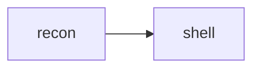

# th3hunger.github.io

Personal blog of 0xth3hunger. Static site built with [Hugo](https://gohugo.io/) (v0.169), deployed to GitHub Pages by `.github/workflows/deploy.yml` on every push to `main`.

## Write a post

```bash
hugo new content posts/my-post-name     # creates content/posts/my-post-name/index.md
```

- Put images next to `index.md` in the same folder and use ``.
- `category` must be `technical`, `research` or `personal`. Anything else stops the build.
- New posts start as `draft: true`. Set it to `false` (or delete the line) to publish.
- The URL is the folder name: `/blog/my-post-name/`.

### Markdown cheat sheet

````markdown
## Section heading            (shows in the outline; ### for sub-sections)

```bash                       (any language; optional: {title="x.py" hl_lines=[2] linenos=true})
nmap -sC -sV 10.10.10.10
```

> [!NOTE]                     (also TIP, IMPORTANT, WARNING, CAUTION; custom title: > [!TIP] My title)
> Text inside the callout.

| col | col |
|-----|-----|
| a   | b   |

     (on its own line; click to zoom)



Inline math $E=mc^2$, block math:

$$
x = \frac{-b \pm \sqrt{b^2-4ac}}{2a}
$$

A literal dollar sign: \$5.  Footnote[^1].

[^1]: The footnote text.
````

## Preview

```bash
hugo server -D        # http://localhost:1313/  (-D includes drafts)
```

## Publish

Commit and push to `main`. GitHub Actions builds and deploys in about a minute.

## Where things are

| path | what |
|---|---|
| `content/` | all Markdown: `_index.md` (home), `posts/`, `projects/` (About = your LinkedIn; old `/about/` forwards there via `static/about/`) |
| `hugo.toml` | site settings, social links, allowed categories |
| `layouts/` | page templates; `_markup/` turns Markdown into the design's code blocks, callouts, figures, math, diagrams |
| `assets/css/design/` | the design's CSS, unchanged. Additions go in `assets/css/extras.css` |
| `assets/js/site.js` | explorer, tabs, Ctrl+P search, filters, copy buttons, outline, lightbox, diagrams |
| `assets/og/` | layers and fonts for the 1200×630 share images |
| `static/vendor/` | KaTeX 0.18.4 CSS/fonts and Mermaid 12.2.0, self-hosted |
